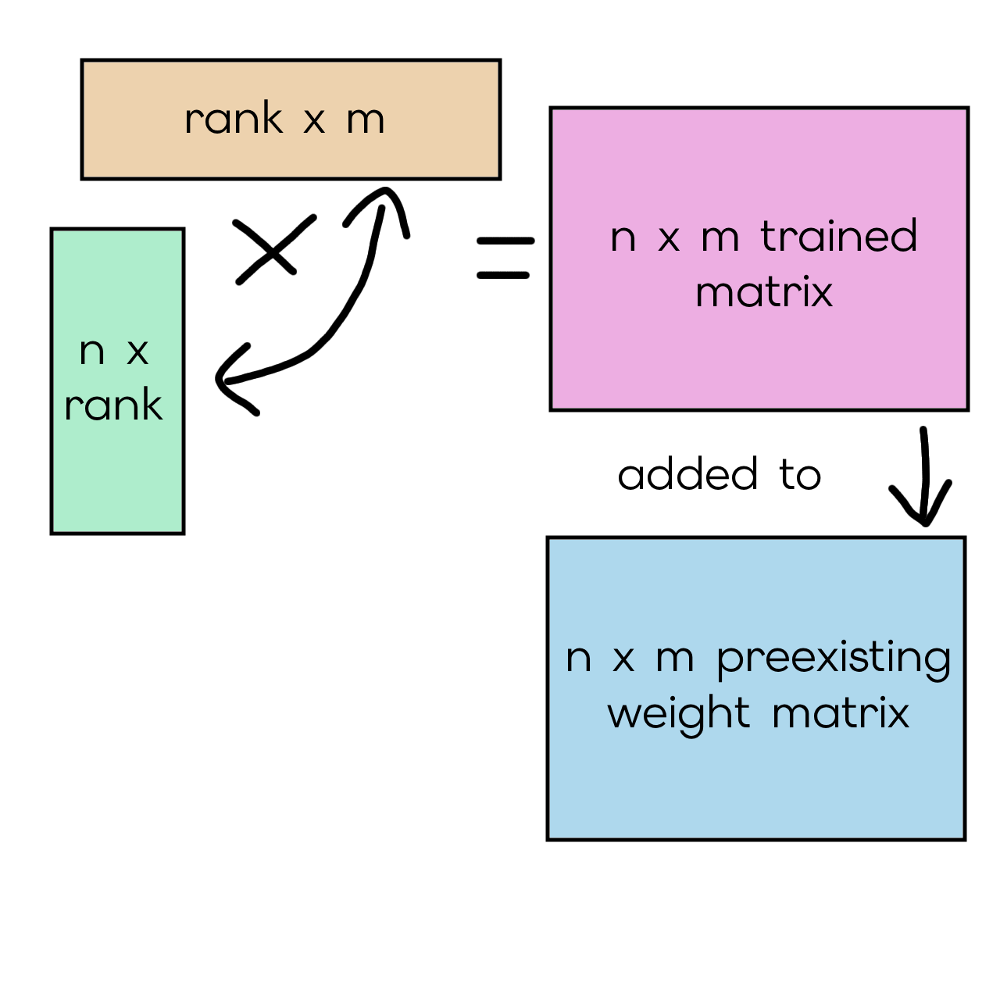
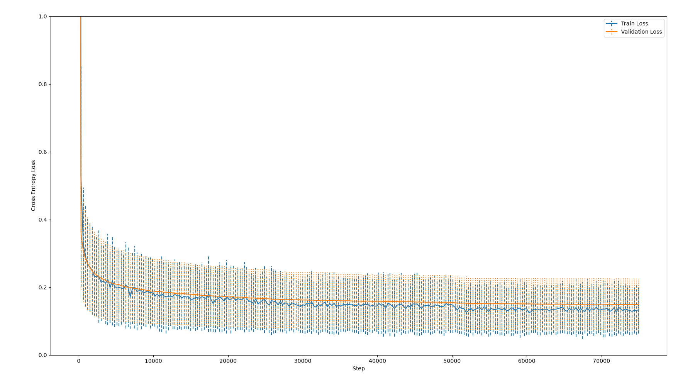
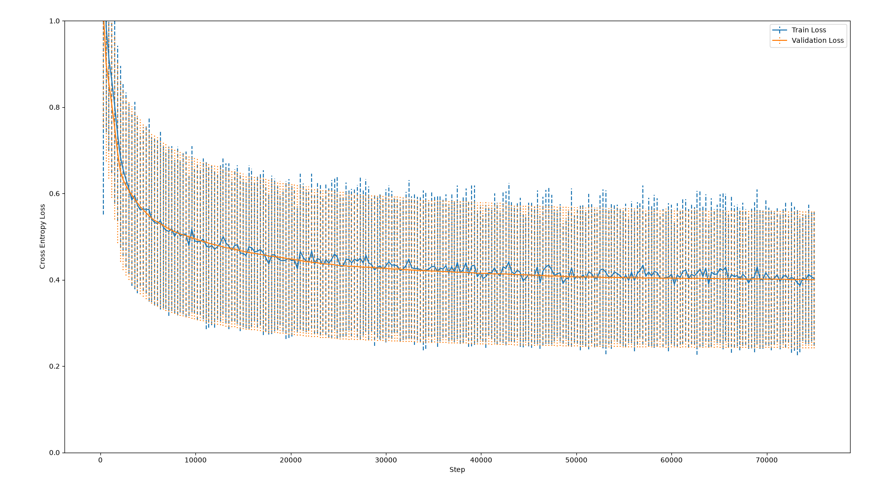
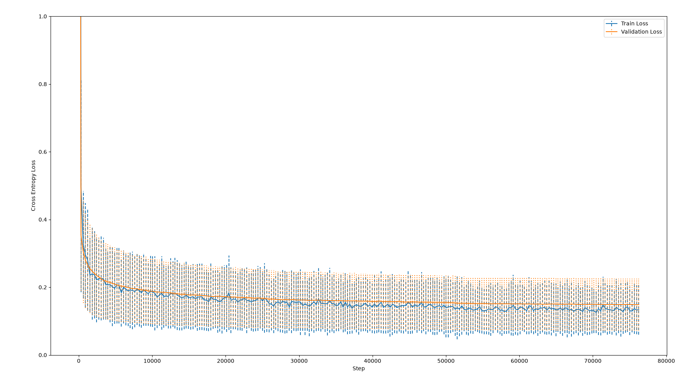
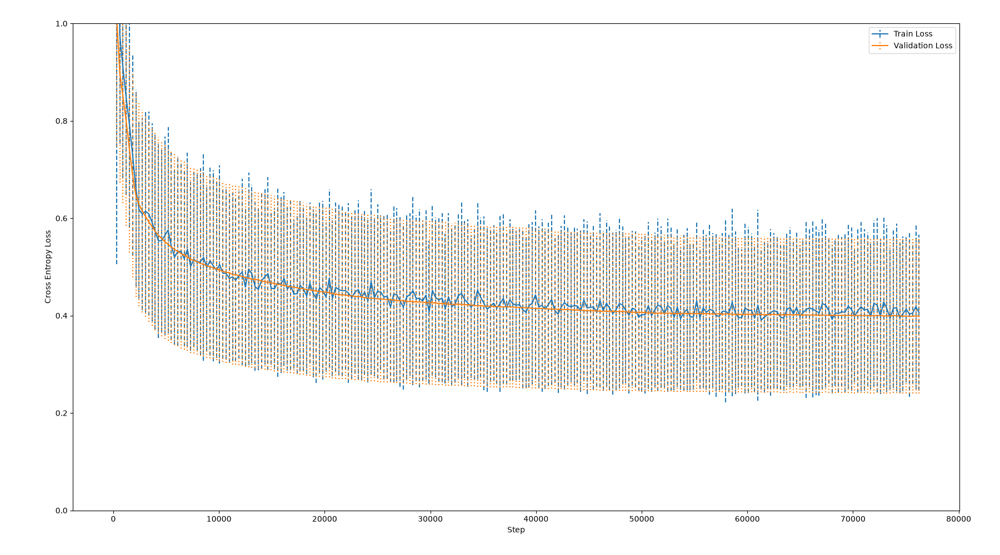

# Layman Summarisation of BioLaySumm Medical Reports using GPT-2
> Author: Gareth Guce, 48817871

To allow for patient autonomy and reduction of healthcare anxiety, patients need to read and understand their own clinical radiology reports. This is hampered by the fact that these reports contain medical jargon and are too complex to understand by the layperson, preventing what we want. My solution here is a bespoke LLM that translates complex medical reports to reports readable by the average person.

## Algorithms/Models Used
### The Model
GPT-2 (Generative Pretrained Transformer 2) is a Large Language Model architecture based on the decoder part of the transformer architecture developed by OpenAI.

The decoder works by first decomposing the input (which is a sequence of both user input and model output so far) into tokens. These tokens are fed into the embedding feed forward network (FFN), and token positions are injected into these embeddings through positional encoding. These embeddings are then fed through a sequence of transformer blocks, which include a multi head self attention (MHSA) block, and a fully connected network. The multi head self attention block contains weight matrices that transform embeddings into query, key, and value matrices (note that in MHSA, there are usually multiple query, key, and value weight matrices, like channels in convolutions) through multiplying the input embeddings. The query matrices and key matrices are multiplied (and normalised through a division by the square root of the key dimension and softmax) to make a context vector representing similarities between all pairs of tokens. This multiplication makes it so that for each input token, it 'attends' to every other token in the sequence. This context vector is then multiplied with the value matrix to encode what should be the next token in the sequence. This is then fed through another fully connected neural network (FCNN) for further understanding before being passed to the next transformer block or the end. The end components of the GPT take the current output so far through another FCNN and through a softmax function, mapped to the set of all possible output tokens. These output tokens represent the next possible token in the sequence.

Transformers and multi head self attention have the advantage of deeper understanding of variable length sequences through every token attending to both itself and all other tokens in a sequence. This leads to greater semantic understanding of the input text. 

To prevent MHSA from having tokens attend to future tokens during training, attention masking is used, where a triangular matrix is applied to the product of the query and key matrices before the softmax function and multiplication with the value matrix.

The GPT architecture also uses other features such as dropout layers for preventing overfitting, layer norms for easier training and consistent behaviour, and skip connections for information preservation and better gradient flow for faster training convergence.


The image above features GPT-1's architecture. GPT-2 improves upon GPT-1 through a larger parameter count and a larger training corpus, leading to emergent instruction following behaviour such as summarisation, language translation, and the ability to answer questions about a text.

GPT-2 comes in four sizes (according to their huggingface page), small (124M parameters), medium (355M parameters), large (774M parameters), and extra large (1.5B parameters)

## Fine Tuning
Fine tuning is the process of training an existing set of pretrained model weights on performing better in a specific task, such as coding, chatting, roleplay, translation, or summarisation. This can be done in multiple ways, like supervised fine tuning (where the model is trained to predict the next token for domain specific training data) and reinforcement learning (where the model is trained to maximise a reward, such as human feedback or outcomes of generated code). 

In this project, I did instruction tuning through supervised fine tuning, where trained the pretrained GPT-2 model on a specific input format that instructs it to summarise complex reports. This input format detailed the complex report, and the layperson summary. The model was trained to follow this input format and return a summarised version of the report.

## Low-Rank Adaptation
Low-Rank Adaptation (LoRA) is a finetuning method that freezes pretrained model weights and instead injects low rank matrices onto the weight matrix of the model, which greatly reduces the number of parameters to train. This parameter reduction leads to faster training times and less memory usage.

Say our weight matrix $W$ is $n \times m$, we want to add to it an $n \times m$ matrix $T$. The matrix we want to add is constructed from the multiplication of two matrices, $P$ and $K$. $P$ is $n \times r$ and $K$ is $r \times m$, where $r$ is our rank. $PK = T$, and we use $T+W$ in model inference. Training involves modifying the parameters in $P$ and $K$.



In this project, I investigated the viability of LoRA finetuning for medical report summarisation in GPT-2.

## Dataset
The dataset used in this project is the [BioLaySumm](https://huggingface.co/datasets/BioLaySumm/BioLaySumm2025-LaymanRRG-opensource-track) dataset, a collection of medical reports, their summarisations, and associated images. In this project, the images were not used for training or inference. The data came pre split into training rows (150k rows), validation rows (10k rows), and test rows (10.5k rows). 

The test rows came with no layperson summaries, and so for benchmarking in this project, I split the validation set (which had both medical and layperson summaries) 80-20, where 80% is used in validation for hyperparameter tuning and 20% is held out in evaluation. The result is \~8k rows for validation, and \~2k rows held out for evaluation, The code for this can be found in `dataset.py`, and is done by offsetting the base index of `__getitem__`.

Splits:
- Training: Used for training the model, finetuning it for medical report summarisation for laypersons.
- Validation: Used for evaluation during training and approximating generalisation loss during training. This set is used particularly for hyperparameter tuning, and to ensure the model is capable of generalisation.
    - NOTE: In training, due to the long training times (Roughly \~2+ hours per epoch, due to the large dataset), only the first 300 (50 validation steps * batch size of 6) validation rows are used in validation loss calculation. Evaluating the whole validation set just for validation loss takes 2 minutes, and having explicitly 250 steps (spread throughout training, every $\lfloor \frac{n}{250} \rfloor$ steps, where n is the total number of training steps) for validation checking, leads to an additional 500 minutes of time spent in the training loop not training, or 8 hours. So only using 50 steps to do validation takes \~5 seconds per validation step, leading to an additional \~21 minutes in training rather than 8 hours.
- Test AKA Hold out: Used for evaluation in `predict.py`. To prevent me from overfitting the hyperparameters on the validation set during training, I set out this test split for evaluating finetuned models.

### Data Augmentation and Preprocessing
To make the model follow summarisation instructions, medical and layperson reports are put into instruction formats. These instruction formats make the model respond to summarisation requests, allow for separation of model outputs to medical and simplified outputs, and allow for inputting medical and layperson reports in the same sequence to the decoder-only transformer GPT model.

For the main training process, this format was used, with special tokens for instructions, the medical report part, and the summary part.

```
<inst>Summarise the following for a 6th grade layperson reading level in 1 to 2 sentences</inst>
<report>"{MEDICAL SUMMARY HERE}"</report>
<begin>"{LAYPERSON SUMMARY HERE}"
```

For evaluation of the base GPT-2 model, this format was used, where no special tokens from the above format were used as the model was not trained to use them.

```
Summarise the following for a 6th grade layperson reading level in 1 to 2 sentences:
"{MEDICAL SUMMARY HERE}" 
Summary:
"{LAYPERSON SUMMARY HERE}"
```

In development, this format was used before special token addition was implemented. This format was not used for any full training run, and was instead used as part of smoke tests so that I could make sure my own code was working.

```
{MEDICAL SUMMARY HERE} TLDR; {LAYPERSON SUMMARY HERE}
```

After putting the medical and layperson reports into a specific format, the pytorch dataset class for the BioLaySumm dataset tokenises the formatted data, and pads it to the max sequence length using the end-of-sentence token, forcing the model to not predict padding tokens. This allowed the sentence to be passed directly to a model's forward function after being sent to GPU memory.

### Synthetic Data Generation
Some training runs used synthetically generated data. This synthetic data was generated by a larger LLM (Qwen 3.6 35B A3B, a 4-bit quantisation, running on my laptop through llama.cpp, with reasoning disabled). My script `generate_synthetic.py` iterated through the first 2500 rows of the BioLaySumm training data and used the medical reports from them to generate new data through rewording and summarisation. For a given medical report , the large LLM was first fed this prompt:
```
Please rewrite the following in roughly the same length. Write nothing else. \"{MEDICAL SUMMARY HERE}\"
```

And then this prompt:
```
Please rewrite and summarise the following, keep it roughly the same length, reword it to a 6th grade reading level, keep the summary third person. Write nothing else. \"{MEDICAL SUMMARY HERE}\"
```

This resulted in 2500 newly generated report-summary pairs. Some samples include:
> REPORT SAMPLE 1800: The azygos lobe represents a common anatomical variant. No significant pathological abnormalities were identified.

> SUMMARY SAMPLE 1800: The azygos lobe is a normal part of the body. No health problems were found.

> REPORT SAMPLE 67: Bilateral pleural effusion, mostly on the left side, accompanied by a fracture of a right rib.

> SUMMARY SAMPLE 67: There is extra fluid in the space between the lungs and chest wall, with more on the left side. There is also a broken rib on the right side.

My justification behind this is that a larger dataset of report-summary pairs will improve the model's performance in both ROUGE scores and manual inspection, as the model has a larger diversity of text to be finetuned on. With rewritten reports and summaries of existing data, the model will also be forced to deeply understand the relations between words in reports rather than just memorising preexisting summaries for given reports, helping with generalisation. What I did here is also technically some form of distillation (where a smaller model is trained on a larger model's outputs, or token predictions), and the usage of this generated data from a smarter model will theoretically improve the performance of the small GPT-2 model.

Synthetic data was generated using the `generate_synthetic.py` script, using the command `uv run generate_synthetic.py --limit-rows 2500` in the working directory of this markdown file.

## How to use and reproduce results
The only major dependencies here are [uv](https://docs.astral.sh/uv/), the huggingface cli, and python 3.14. Running any script in this repository (i.e using `uv run train.py --help`) will immediately download and install all other dependencies, including but not limited to:
- pytorch
- huggingface
- huggingface transformers
- matplotlib
- peft
- huggingface datasets
- openai API python library
A more comprehensive list of dependencies can be found in `pyproject.toml`

Minimum system requirements (or rather, the specs I was able to fit this is) are 16GB+ of RAM, and a graphics card with 8GB+ of VRAM. Storage should be large enough to fit the dataset (\~29.3MB) and the pretrained model (\~548MB). This project and its training was done on Arch Linux, so anything else like Windows or MacOS is untested.

This project consists of the following scripts, files, and folders:
- `modules.py`: Holds input formats and the classes for them, functions for getting models (pretrained from huggingface or weights saved locally) and their corresponding tokeniser, functions for appending LoRA parameters to those models, functions for calculating cross entropy loss and rouge score for a given split of the dataset (through an inputted PyTorch DataLoader), and summary generation function for a given medical report prompt and its ground truth summary.
- `dataset.py`: Holds the `BioLaySumm` dataset class, which inherits from the PyTorch dataset class. It's an adaptor for the huggingface dataset that allows it to be augmented and used with my code. It also holds the `BLSSynthetic` dataset class, which concatenates both the original BioLaySumm training data with synthetically generated data.
- `train.py`: Does the model training through finetuning model on training dataset. Outputs a folder holding model weights and configurations that can be used in inference (i.e `predict.py`). Run `uv run train.py --help` to see command line arguments, which controls training hyperparameters. Options include the following:
```
--output-folder OUTPUT_FOLDER
                    Where to store output of training (default is a folder in the current working directory called "modelout")
--batch-size BATCH_SIZE
                    Batch size in training (default is 6)
--save-every SAVE_EVERY
                    Save every n steps, also does evaluation of metrics (val loss, train loss, ROUGE). If negative, it saves every max-steps/n (default is 250)
--max-steps MAX_STEPS
                    Max number of steps to train for (independent of epoch amount, takes priority over epoch amount), -1 to train for n epochs * number of batches in
                    training dataset (default is -1)
--n-epochs N_EPOCHS   Number of epochs to train for (default is 3)
--model-name MODEL_NAME
                    Huggingface model to train from (default is 'openai-community/gpt2')
--num-rows NUM_ROWS   Maximum number of rows to use in training dataset (default is None)
--max-eval-steps MAX_EVAL_STEPS
                    Maximum number of steps to evaluate for when calculating ROUGE and validation loss. -1 to evaluate for all batches in validation dataset (default is
                    50)
--lora                Train a LoRA instead of a finetuned model (disabled by default)
--input-format INPUT_FORMAT
                    Format for inputting report and summary to model. Options include 'TLDRFormat', 'InstructionFormat', 'SpecialFreeInstruction' (default is
                    InstructionFormat)
--synthetic           Enable usage of synthetic data during training
--synthetic-only      Only use synthetic data in training. Only works if synthetic data is being used
--synthetic-csv SYNTHETIC_CSV
                    CSV file of synthetic data (medical report and summary pairs). Only works if synthetic data is being used
```
- `predict.py`: Runs evaluate suite on input model (input through the `--input-folder` parameter, such as a folder like `./modelout` for example). Does cross entropy loss and rouge score calculation on entire dataset holdout split, and does summarisation of example test cases using the model. All of these are printed out. Run `uv run predict.py --help` to see command line arguments, which help specify which model and generation parameters to use. Options include the following:
```
--input-folder INPUT_FOLDER
                    Where to load pretrained model from (default is a folder in the current working directory called "modelout")
--model-name MODEL_NAME
                    Name of base model, used for getting tokeniser (default is "openai-community/gpt2")
--max-eval-steps MAX_EVAL_STEPS
                    Maximum number of steps to evaluate for when calculating ROUGE and validation loss. -1 to evaluate for all batches in validation dataset (default is
                    -1)
--input-format INPUT_FORMAT
                    Format for inputting report and summary to model. Options include 'TLDRFormat', 'InstructionFormat', 'SpecialFreeInstruction' (default is
                    InstructionFormat)
```
- `generate_plots.py`: Code that takes `to_plot.json` files in each folder named `gpt2-*` and generates training and validation cross entropy loss plots over the training run. Do `uv run generate_plots.py` to generate each of these plots to the `imagery` folder. This script is mainly to help me write the README.md file.
- `generate_synthetic.py`: Uses an LLM from an OpenAI API compatible endpoint to iterate through the BioLaySumm dataset, generating synthetic data through reworded reports and new summarisations. Command line options (from `uv run generate_synthetic.py --help`) include the following:
```
--url URL             URL of OpenAI API compatible endpoint (Default is a local llama.cpp endpoint)
--model MODEL         Model from API that should be used (Default is a specialied Qwen model a local llama.cpp endpoint)
--key KEY             API key for OpenAI API compatible endpoint (Default is "key")
--limit-rows LIMIT_ROWS
                    Number of rows from BioLaySumm dataset to be rewritten. -1 for all rows.
--output-csv OUTPUT_CSV
                    Output CSV of rewritten data (Default is "synthetic.csv")
```
- `README.md`: Project report, you are reading this right now.
- `imagery/`: Folder containing images used in this project.
- `synthetic.csv`: CSV file of 2500 rows of synthetic data. Generated by `generate_synthetic.py`.
- `train.fish`: Shell script containing the commands for the training runs in this project, run in the working directory of where this README.md file is.
- `predict.fish`: Shell script containing evaluation runs of all models, run in the working directory of where this README.md file is.

## Evaluation
Metric evaluation was done by creating summaries of all report-summary pairs in the hold out split, and calculating ROUGE scores from predicted and original summary pairs. In evaluating the outputs of the models I trained on the holdout split, I used the following metric scores:
| Metric Name | Description |
| -------------- | --------------- |
| ROUGE-1 | Measures ratio of unigrams (single words) that appear in both summaries. This is usually an F1 score, consisting of precision (number of unigrams in the predicted summary that also appear in the original summary) and recall (number of unigrams in the original summary that appear in the predicted summary). |
| ROUGE-2 | Like ROUGE-1 but instead of being an F1 ratio of unigrams that appear in both summaries, its an F1 ratio of bigrams (pairs of consecutive words) that appear in both summaries. |
| ROUGE-L | Longest Common Subsequence. Calculated through the number of words in the predicted summary that are in the same order as in the original summary, divided by the number of words in the original summary. |
| ROUGE-L-Sum | Still uses the longest common subsequence, but looks at the summaries sentence wise (i.e through full stops or newlines). Calculated by splitting both summaries into their sentences, then calculating ROUGE-L on each sentence pair. Then returns the average of the ROUGE-L scores. |

The problem with ROUGE scores is that they only consider the words and text itself, and not the deeper semantic meaning. ROUGE scores only look at the intersection of words common in both predicted and original summaries, and do not look at semantics. For example, the phrase `The newborn cat is overweight` can be summarised to `The kitten is fat`, and would have a low ROUGE score as the calculations for it do not take into account the semantic similarities between `overweight` and `fat`, or `newborn cat` and `kitten`. Because of its ability to not be able to understand semantics, it cannot be used reliably to measure for factuality, understandability, or hallucinations. For example, the phrase `You are diagnosed with cancer` can be summarised correctly into `You do have cancer` or incorrectly into `You don't have cancer`, and both summaries would have equal or similar ROUGE scores. Because patients need factual yet understandable information for their own autonomy and clinical safety, ROUGE as a metric is simply not enough to evaluate summary quality.

Because of the unreliability of ROUGE scores for this task, I also did manual evaluation on these following report-summary pairs, that I believed represent the entire dataset. I manually inspected the predicted output of these to evaluate unquantifiable metrics like hallucination rate, faithfulness to original medical report, readability by a person at the 6th grade reading level, and coherence.

### REPORT 1
REPORT: 
> No significant findings.

SUMMARY: 
> There are no important issues found.

I used this report as a significant of the rows in all of the splits report the absence of anything significant. This prompt also has the possibility of demonstrating the diversity of outputs for the same input.
### REPORT 2
REPORT: 
> Comparison with the previous study dated 06 08 2012 shows the appearance of a right basal pneumothorax. Subcutaneous emphysema in the right thoracic wall. Radiological worsening of diffuse bilateral alveolar involvement.

SUMMARY: 
> "Compared to the study from June 8, 2012, there is now a condition called a right basal pneumothorax, which means air has leaked into the space between the lungs and chest wall on the right side. There is also air trapped under the skin of the right chest wall. The overall picture of the lungs has gotten worse, showing more involvement of both lungs.

This prompt has a date in it, and it can be used to determine how well a model handles dates. This prompt also shows the need for understandability, as a `right basal pneumothorax` would be indecipherable to a layperson reading this, and the provided summary demonstrates that the model should be able to explain what it is.
### REPORT 3
REPORT: 
> Signs of COPD. Images are compatible with a healed fracture of the posterior arch of the 10th right rib.

SUMMARY:
> Signs of chronic obstructive pulmonary disease (COPD) are present. The images also show that there was a fracture in the back part of the 10th rib on the right side, which has now healed.

This prompt and summary pair demonstrates that models should be able to handle medical abbrieviations such as COPD, as some items in the dataset would have existing medical abbrieviations. This summary also directly refers to the image that this report is typically paired with, showing that the model should be able to handle reports with external references without hallucinating.
### REPORT 4
REPORT: 
> Right parahilar infiltrate and atelectasis. Increased retrocardiac density related to atelectasis and consolidation associated with right pleural effusion. Clinical data is important for correct radiological assessment.

SUMMARY: 
> There is a cloudiness near the right lung's airways and a part of the lung has collapsed. The area behind the heart is denser, which could be due to the collapsed lung and a possible lung infection along with fluid around the right lung. It's important to consider the patient's medical history for a proper understanding of the x-ray.

This report demonstrates the importance of translating medical jargon to layperson understandable information, as its corresponding summary makes sure to explain the underlying meaning behind each medical condition instead of purely just reducing the word count.

### Evaluation Hyperparameters
For evaluating each finetuned/pretrained model, the following parameters were used.

| Hyperparameter | Value |
| -------------- | --------------- |
| Batch Size | 16 |
| Dataset Split | Test "Split" (See Dataset section) |
| Num Data Items for Evaluation | \~2000 |


## Training Runs
For this project, 4 training runs were done. For all 4 training runs, the following hyperparameters were used. 

| Hyperparameter | Value |
| -------------- | --------------- |
| Learning Rate | 5e-5 |
| Batch Size | 6 |
| Optimiser | AdamW |
| Number of Epochs | 3 |
| Loss | Cross Entropy Loss |
| Input Format | `InstructionFormat` (see Data Augmentation section in Dataset) |
| Data Collator (for use in DataLoader) | `DataCollatorWithPadding` |
| Learning Rate Scheduler | Cosine Annealing LR |
| Base Model | GPT-2 135M |
| Tokenised inputs padded to | 512 tokens |
| Padding Token | EOS Token |
| Base Weights | GPT-2 135M |
| Base Tokeniser | GPT-2 Tokeniser |

These are the four individual training runs done for this project.
- Full Finetune of GPT-2 135M
- LoRA Finetune of GPT-2 135M
- Full Finetune of GPT-2 135M with synthetic data appended to main dataset
- LoRA Finetune of GPT-2 135M with synthetic data appended to main dataset

LoRA Finetunes were done with a rank of 8, using default settings in the LoraConfig class from huggingface's `peft` library.

Without the synthetic data, training took 75228 steps, and evaluation+saving was done every 300 steps. With the synthetic data, training took 76479 steps, and evaluation+saving was done every 305 steps.

Without using the LoRA, finetuning the model weights itself leads to 124443648 trainable parameters. Using LoRA and training the LoRA matrices instead of the model weights leads to 294912 trainable parameters.

## Results
| Model | ROUGE-1 | ROUGE-2 | ROUGE-L | ROUGE-L-Sum | Time Taken for Inference | Max Vram Used In Inference | Max Vram Used in Training | Tok/Sec |
| --- | --------------- | --------------- | --------------- | --------------- | --- | --- | --- | --- |
| Base GPT-2 | 0.04310 | 0.00731 | 0.04310 | 0.03939 | 9:10 | 1.26GB | N/A | 211.04t/s |
| Full Finetune | 0.74452 | 0.57926 | 0.70014 | 0.70030 | 2:30 | 1.26GB | 6.09GB | 289.31t/s |
| LoRA Finetune | 0.57202 | 0.37093 | 0.51395 | 0.51352 | 8:09 | 1.08GB | 4.88GB | 220.99t/s |
| Finetune with Synthetic Data| 0.74354 | 0.57944 | 0.69947 | 0.69957 | 2:24 | 1.26GB | 6.09GB | 280.51t/s |
| LoRA with Synthetic Data | 0.57909 | 0.37467 | 0.52023 | 0.52049 | 7:27 | 1.08GB | 4.88GB | 227.09t/s |

Looking at the ROUGE scores, memory usage, token speeds, and inference time, we can see some interesting initial observations:
- Using a LoRA adapter reduces VRAM in training, and surprisingly inference. 
- Models such as the Base GPT-2, and both LoRA models take more inference time and have less token speeds. This is presumably due to these models having some prompts where they repeat sentences, and therefore take more time to iterate through the evaluation suite and generate more tokens.
- Full finetunes have higher ROUGE scores across the board, most likely due to not repeating sentences.

These scores and times were done on a laptop with 16GB of RAM and a 4060 with 8GB of VRAM.

### Base GPT-2

| ROUGE-1 | ROUGE-2 | ROUGE-L | ROUGE-L-Sum | Time Taken for Inference | Max Vram Used In Inference | Tok/Sec |
| --------------- | --------------- | --------------- | --------------- | --- | --- | --- |
| 0.04310 | 0.00731 | 0.04310 | 0.03939 | 9:10 | 1.26GB | 211.04t/s |


#### Summary 1

> The authors conclude that the authors of this study were not able to find any significant differences between the two groups of students.  The authors conclude that the authors of this study were no... *(Repeated words removed for brevity)*

ROUGE Scores: `ROUGE-1: 0.00000 | ROUGE-2: 0.00000 | ROUGE-L: 0.00000 | ROUGE-L-Sum: 0.00000`

Factual faithfulness/hallucinations: The model hallucinates that this report comes from a study with authors that involves two groups of students.

Information Completeness: The base GPT2 model does not reference anything regarding 'no significant findings'.

Layperson Readability: Sentences are repetitive, and the layperson reading would get no information out of the summary.

#### Summary 2

> The authors conclude that the right basal pneumothorax is a result of a pulmonary embolism. The authors conclude that the right basal pneumothorax is a result of a pulmonary embolism.
The authors conclude that the right basal pneumothorax is a result of a pulmonary embolism.
The authors conclude that the right basal pneumothorax is a... *(Repeated words removed for brevity)*

ROUGE Scores: `ROUGE-1: 0.09639 | ROUGE-2: 0.01937 | ROUGE-L: 0.09639 | ROUGE-L-Sum: 0.05301`

Factual faithfulness/hallucinations: The summary hallucinates the involvement of pulmonary embolisms, which were not mentioned at all in the report. Supposedly, right basal pneumothoraxes can result from pulmonary embolisms (blood clots) according to my mother who is a nurse, but this is not relevant to the original report at all. The summary also hallucinates that the origin of the report comes from a study with authors.

Information Completeness: Other than the existence of the 'right basal pneumothorax', nothing else is referred to, not even the date.

Layperson Readability: The repeating sentences uses dense medical jargon that no layperson would understand.

#### Summary 3

> The following is a list of the most common signs of COPD.  The following is a list of the most common signs of COPD.  The following is a list of the... *(Repeated words removed for brevity)*

ROUGE Scores: `ROUGE-1: 0.04306 | ROUGE-2: 0.00962 | ROUGE-L: 0.04306 | ROUGE-L-Sum: 0.04306`

Factual faithfulness/hallucinations: The generated text hallucinates that it is not a summary, but instead a list of signs of COPD.

Information Completeness: Other than the existence of COPD, nothing else is referred to.

Layperson Readability: COPD is not spelled out or explained, leaving the layperson with no knowledge about what it is.

#### Summary 4

>  The above is a summary of the above information.  The above information is not a complete list of the above information.  It is a summary of the above information.  It is not a complete list of the above information.  It is not a complete list of the above information.  It is not a... *(Repeated words removed for brevity)*

ROUGE Scores: `ROUGE-1: 0.07440 | ROUGE-2: 0.01319 | ROUGE-L: 0.07440 | ROUGE-L-Sum: 0.07440`

Factual faithfulness/hallucinations: The generated text does not summarise anything, and instead hallucinates sentences about the existence of a summary.

Information Completeness: Nothing in the original medical report is referred to.

Layperson Readability: The layperson reading would be confused by the . They would also get no information about their original condition.

#### Model Conclusions
Using the Base GPT-2 with the `SpecialFreeInstruction` input format (as described in the Dataset section of this README.md), we get absymal results. The base GPT-2 model gives terrible 'summaries', with low ROUGE scores, and guaranteed repetition. I would advise not using this for anything. The fact that this base model demonstrates terrible performance proves that finetunes for this task (for a model of this size) are superior in performance.

I believe this is because of the size of the model. Because of its smaller size, it is less likely to follow instructions and more likely to repeat itself. Because the original paper shows that instruction following to be an emergent behaviour of increasing the model size between GPT-1 and GPT-2, it demonstrates limited attempts at summarisation. However the base GPT-2 has never been finetuned to do instruction following (like an instruct model or chat model), and therefore performs poorly in this task.

### Full Finetune



(NOTE: The validation losses in this plot and all other plots were calculated using only 300 out of the 8000 validation data points during each evaluation step in training. Using all of the validation points would have lead to longer training times, where time would be wasted not training.)

| ROUGE-1 | ROUGE-2 | ROUGE-L | ROUGE-L-Sum | Time Taken for Inference | Max Vram Used In Inference | Max Vram Used in Training | Tok/Sec |
| --------------- | --------------- | --------------- | --------------- | --- | --- | --- | --- |
| 0.74452 | 0.57926 | 0.70014 | 0.70030 | 2:30 | 1.26GB | 6.09GB | 289.31t/s |


#### Summary 1:

> There are no important issues found.

ROUGE Scores: `ROUGE-1: 1.00000 | ROUGE-2: 1.00000 | ROUGE-L: 1.00000 | ROUGE-L-Sum: 1.00000`

Factual faithfulness/hallucinations: The summary completely captures the fact that there are no issues in the medical report.

Information Completeness: No new medical information is revealed, as there should be.

Layperson Readability: A layperson could understand the idea of there being no issues in the medical image.

#### Summary 2

> Compared to the study from June 8, 2012, there's now a new air leak in the lower right part of the lung. There's also air trapped under the skin on the right side of the chest. The x-ray shows that the widespread lung involvement has gotten worse.

ROUGE Scores: `ROUGE-1: 0.63158 | ROUGE-2: 0.37500 | ROUGE-L: 0.50877 | ROUGE-L-Sum: 0.50877`

Factual faithfulness/hallucinations: Gets the definition of a right basal pneumothorax wrong, the generated summary says that is a 'new air leak in the lower right part of the lung', whilst the original summary defines it as a 'leak of air into the space between the lungs on the right side'. The generated summary also refers to the involvement of the lungs as 'widespread', a description not used in the original summary.

Information Completeness: Does acknowledge the date of the previous study. Simplifies the 'Subcutaneous emphysema in the right thoracic wall' as 'air trapped under the skin on the right side of the chest', not referring to the wall at all.

Layperson Readability: Spells out the simplified definitions of the diagnoses from the medical report in simple terms, allowing a layperson to understand easily.

#### Summary 3

> The report indicates Chronic Obstructive Pulmonary Disease (COPD), which is a long-term lung condition. The images also suggest that there might have been a healed fracture in the back part of the 10th rib on the right side.

ROUGE Scores: `ROUGE-1: 0.71233 | ROUGE-2: 0.53521 | ROUGE-L: 0.65753 | ROUGE-L-Sum: 0.65753`

Factual faithfulness/hallucinations: Is able to state correctly what COPD stands for.

Information Completeness: All pieces of information in the original medical report and summary are present in the generated summary, and it even gives the bonus of saying that COPD is a long term condition.

Layperson Readability: The summary tells what COPD stands for, but does not explain it any further. The summary replaces the term 'posterior arch' with the simplified 'back part of the 10th rib'. A layperson should be able to understand easily, but would need to ask what COPD is.

#### Summary 4

> There is an area of lung inflammation near the right lung's main airway and some lung collapse. The density behind the heart is increased, which could be due to lung collapse and lung tissue thickening along with fluid around the right lung. Clinical data is important to accurately assess the x-ray results.

ROUGE Scores: `ROUGE-1: 0.61538 | ROUGE-2: 0.36522 | ROUGE-L: 0.58120 | ROUGE-L-Sum: 0.58120`

Factual faithfulness/hallucinations: States incorrectly that heart density increases are due to 'lung tissue thickening' instead of 'lung infection'. The omission of this lung infection would make this summary very dangerous if presented to the patient.

Information Completeness: All information except for the possibility of a lung infection is within the generated summary.

Layperson Readability: Refers to 'Right parahilar infiltrate and atelectasis' as 'lung inflammation' instead of the slightly less understandable 'cloudiness'. As the summary uses simple explanations instead of obtuse jargon, a layperson could easily understand the report.

#### Model Conclusions
This model is able to show both high ROUGE scores, coherent text, understandable summaries, information completeness, and a degree of factuality. However, these summaries also contain some factual errors that would compromise patient understanding, such as in summary 4. When compared to the other models, it seems to outperform them in areas like factual accuracy. I believe problems in this task such as errors and hallucinations are because of both the size of the model and the very nature of LLMs, as the model's size restricts semantic understanding, and LLMs have been shown to still be prone to hallucinations. 

### LoRA Finetune



| ROUGE-1 | ROUGE-2 | ROUGE-L | ROUGE-L-Sum | Time Taken for Inference | Max Vram Used In Inference | Max Vram Used in Training | Tok/Sec |
| --------------- | --------------- | --------------- | --------------- | --- | --- | --- | --- |
| 0.57202 | 0.37093 | 0.51395 | 0.51352 | 8:09 | 1.08GB | 4.88GB | 220.99t/s |

#### Summary 1

> There are no important issues found.

ROUGE Scores: `ROUGE-1: 1.00000 | ROUGE-2: 1.00000 | ROUGE-L: 1.00000 | ROUGE-L-Sum: 1.00000`

Factual faithfulness/hallucinations: The summary completely captures the fact that there are no issues in the medical report.

Information Completeness: No new medical information is revealed, as there should be.

Layperson Readability: A layperson could understand the idea of there being no issues in the medical image.

#### Summary 2

> Looking at the images from the study done on June 8, 2012, we can see that the right lung has a large area of lung inflammation. There's a small area of lung inflammation in the right side of the chest wall. The lung tissue looks better than it did before, but there's still a lot of fluid around the lungs.

ROUGE Scores: `ROUGE-1: 0.42857 | ROUGE-2: 0.16129 | ROUGE-L: 0.28571 | ROUGE-L-Sum: 0.28571`

Factual faithfulness/hallucinations: This summary gets a large amount of facts wrong, and creates lots of incorrect explanations that do not line up with the original summary. The generated summary contradicts the original report and summary, stating that the lungs 'look better than it did before'. The generated summary refers to the 'right basal pneumothorax' incorrectly as a large area of lung inflammation in the right lung. The summary incorrectly states that there is a 'small area of lung inflammation' in the right side of the chest wall.

Information Completeness: The summary does reference the fact that this report is being compared to a previous one. It does refer to the involvement of body parts like the right lung, but does not refer to any specific areas of the right lung, like the chest wall or the space between the lungs.

Layperson Readability: The summary uses no medical jargon, and instead uses simple explanations. A layperson at a 6th grade reading level would be able to understand this. The summary is also coherent.

#### Summary 3

> The report shows signs of Chronic Obstructive Pulmonary Disease (COPD). There are also signs of a healed fracture of the back of the 10th rib on the right side.

ROUGE Scores: `ROUGE-1: 0.76190 | ROUGE-2: 0.45902 | ROUGE-L: 0.66667 | ROUGE-L-Sum: 0.66667`

Factual faithfulness/hallucinations: Summary refers to a report instead of images, but this is negligible. Meaning of COPD abbrieviation is correct.

Information Completeness: All facts seem to have been preserved.

Layperson Readability: The abbrieviation COPD has been decomposed to its original words, allowing a layperson to understand what the abbrieviation stands for. Uses simplified terminology in referring to the 'posterior arch'. A layperson should be able to understand this summary.

#### Summary 4

>  There is a buildup of fluid around the right lung and a buildup of fluid around the lungs. There is also a buildup of fluid around the left lung and a buildup of fluid around the lungs. The patient has a history of fluid buildup around the lungs and fluid around the lungs. The patient has a history of fluid buildup around the lungs and fluid... *(Removed repeating sentences for brevity)*

ROUGE Scores: `ROUGE-1: 0.09890 | ROUGE-2: 0.03676 | ROUGE-L: 0.09524 | ROUGE-L-Sum: 0.09524`

Factual faithfulness/hallucinations: The model hallucinates the patient having a history of fluid buildup around the lungs, which is not true. The model incorrectly states that the left lung has fluid, even though it is not involved in the report. The generated text seems to be fixated on fluid in the lungs.

Information Completeness: Little to no facts are left in the summary. Nothing about cloudiness, heart density, or lung collapse.

Layperson Readability: Incoherent repeating sentences prevents a patient with little knowledge of medical terms unable to understand their own condition and the report given to them. 

#### Model Conclusions
This model performs horribly compared to the finetune, with low ROUGE scores, some repeating summaries like in summary 4 (leading to the increased inference evaluation time and reduced token generation speed), and incorrect facts. The model does seem to output coherent, layperson readable text most of the time, and is able to give accurate summaries on easier reports like summaries 1 and 3. Alongside small model size, I believe that this worser performance is due to the low number of parameters in the LoRA adapter, leading to a restricted loss space, making it difficult for a finetuning process to find an optimal set of low rank matrices to place on top of the model weights. Future work could fix this by using 

### Full Finetune with Synthetic Data



| ROUGE-1 | ROUGE-2 | ROUGE-L | ROUGE-L-Sum | Time Taken for Inference | Max Vram Used In Inference | Max Vram Used in Training | Tok/Sec |
| --------------- | --------------- | --------------- | --------------- | --- | --- | --- | --- |
| 0.74354 | 0.57944 | 0.69947 | 0.69957 | 2:24 | 1.26GB | 6.09GB | 280.51t/s |


#### Summary 1

> There are no important issues found.

ROUGE Scores: `ROUGE-1: 1.00000 | ROUGE-2: 1.00000 | ROUGE-L: 1.00000 | ROUGE-L-Sum: 1.00000`

Factual faithfulness/hallucinations: The summary completely captures the fact that there are no issues in the medical report.

Information Completeness: No new medical information is revealed, as there should be.

Layperson Readability: A layperson could understand the idea of there being no issues in the medical image.

#### Summary 2

> Compared to the study from June 8, 2012, there's a new air leak in the lower right part of the lung. There's also air under the skin in the right chest wall. The x-ray shows that both lungs are getting worse with more widespread involvement of the tiny air sacs.

ROUGE Scores: `ROUGE-1: 0.56410 | ROUGE-2: 0.33043 | ROUGE-L: 0.49573 | ROUGE-L-Sum: 0.49573`

Factual faithfulness/hallucinations: Incorrectly states that the 'air leak' is in the 'lower right part of the lung', instead of the 'space between the lungs and chest wall'. Hallucinates the 'involvement' of 'tiny air sacs'.

Information Completeness: No information seems to be omitted from the original report, but there are some factual inconsistences as stated above. References to the date and the report being compared to past data seem to be preserved.

Layperson Readability: This generated summary trades complex medical language for simple (yet incorrect) explanations, allowing a layperson to easily understand.

#### Summary 3

> The report indicates the presence of Chronic Obstructive Pulmonary Disease (COPD), which is a long-term lung condition. The images also suggest that there might be a healed fracture in the back part of the 10th rib on the right side.

ROUGE Scores: `ROUGE-1: 0.72000 | ROUGE-2: 0.54795 | ROUGE-L: 0.66667 | ROUGE-L-Sum: 0.66667`

Factual faithfulness/hallucinations: Presents the 'healed fracture' as a suggestion from the image rather than a definite fact, which I would say is better wording as there should be more investigation on this healed fracture. Otherwise, every fact seems correct.

Information Completeness: No information seems to be withheld.

Layperson Readability: This generated summary seems to be understandable by a layperson, and it is able to expand the abbrieviation of COPD to its full meaning. However, COPD is not explained further.

#### Summary 4

> There is a patchy area of lung inflammation and partially collapsed lung on the right side near the hilum. There is also an increased density behind the heart, which could be due to the collapsed lung and lung tissue thickening along with fluid buildup in the right chest cavity. Clinical data is important to accurately assess the radiological findings.

ROUGE Scores: `ROUGE-1: 0.57377 | ROUGE-2: 0.30000 | ROUGE-L: 0.45902 | ROUGE-L-Sum: 0.45902`

Factual faithfulness/hallucinations: Uses the term 'lung inflammation' instead of cloudiness, which are interchangeable terms, so that isn't a factual mistake. Incorrectly states that density behind the heart increasing could be a result of 'lung tissue thickening' and a fluid buildup in 'the right chest cavity', instead of 'around the right lung'.

Information Completeness: Omits the fact that density behind the heart could be the result of lung infection.

Layperson Readability: Refers to the 'hilum', which is medical jargon that a layperson would not be able to understand. 

#### Model Conclusions
A full weight finetune with the addition of synthetic data leads to ROUGE scores slightly less than the finetune without the synthetic data, but higher than the LoRAs. I would say that this model has worse quality summaries than the finetune without the synthetic data, due to some use of complex medical language along with incorrect facts around symptoms and locations of symptoms. I believe that this may be because of the quality of the synthetic data, as the synthetic data came from a non-frontier reasoning-disabled model with limited medical knowledge. Future work could generate synthetic data through rewording existing data using a higher quality frontier model, with more medical knowledge and reasoning enabled, but that may cost money, time, and may be blocked due to filters.

### LoRA Finetune with Synthetic Data



| ROUGE-1 | ROUGE-2 | ROUGE-L | ROUGE-L-Sum | Time Taken for Inference | Max Vram Used In Inference | Max Vram Used in Training | Tok/Sec |
| --------------- | --------------- | --------------- | --------------- | --- | --- | --- | --- |
| 0.57909 | 0.37467 | 0.52023 | 0.52049 | 7:27 | 1.08GB | 4.88GB | 227.09t/s |

#### Summary 1

> There are no important issues found.

ROUGE Scores: `ROUGE-1: 1.00000 | ROUGE-2: 1.00000 | ROUGE-L: 1.00000 | ROUGE-L-Sum: 1.00000`

Factual faithfulness/hallucinations: The summary completely captures the fact that there are no issues in the medical report.

Information Completeness: No new medical information is revealed, as there should be.

Layperson Readability: A layperson could understand the idea of there being no issues in the medical image.

#### Summary 2

> Looking at the images from the previous study from June 8, 2012, we can see a large cloudiness in the right lung area. There's a condition called a nodule in the right lung wall. The lung tissue looks worse than usual, but there's a worsening of the lung involvement in both lungs.

ROUGE Scores: `ROUGE-1: 0.42373 | ROUGE-2: 0.20690 | ROUGE-L: 0.33898 | ROUGE-L-Sum: 0.33898`

Factual faithfulness/hallucinations: Hallucinates that there is cloudiness (inflammation) in the right lung area (not in the space between the lungs). Incorrectly states the existence of a nodule (a growth of abnormal tissue) instead of trapped air in the right lung/chest wall. Hallucinates 'worsening of lung tissue', a problem not mentioned in the original report.

Information Completeness: As most facts here are incorrect, nearly all important information in the original report is lost.

Layperson Readability: Uses the medical term 'nodule', which a layperson would need a definition of to understand.

#### Summary 3

> The report shows signs of Chronic Obstructive Pulmonary Disease (COPD). There are also signs of a healed fracture of the right rib on the 10th rib.

ROUGE Scores: `ROUGE-1: 0.70000 | ROUGE-2: 0.41379 | ROUGE-L: 0.53333 | ROUGE-L-Sum: 0.53333`

Factual faithfulness/hallucinations: The final part of the summary 'of the right rib on the 10th rib' seems to be a strange wording of 'the 10th rib on the right side', and this wording seems to be incorrect.

Information Completeness: All facts seem to be intact and complete.

Layperson Readability: I believe that a patient with a 6th grade reading level would be able to understand this, but there is a grammatical issue near the end of the summary, which would hamper their understanding. The COPD abbrieviation is fully spelled out, for a patient to understand.

#### Summary 4

> There is a buildup of fluid around the right lung and atelectasis in the lungs. There is also a buildup of fluid around the right lung and a buildup of fluid around the left lung. The patient has a history of fluid buildup in the lungs and fluid around the left lung. The patient has a history of fluid buildup in the lungs and fluid around the left lung. The patient has a history of fluid buildup in the lungs and fluid around the left... *(Removed repeating sentences for brevity)*

ROUGE Scores: `ROUGE-1: 0.11376 | ROUGE-2: 0.04052 | ROUGE-L: 0.10642 | ROUGE-L-Sum: 0.10642`

Factual faithfulness/hallucinations: The generated summary hallucinates the involvement of a left lung that has fluid around it. It also hallucinates the patient having a history of fluid buildup.

Information Completeness: No useful information seems to be within the summary, except for the fact that there is fluid around the right lung.

Layperson Readability: This summary uses medical jargon like 'atelectasis' in its first sentence, which a layperson would not be able to understand. This summary also has repeating sentences of useless information, which blocks the patient from understanding the medical report they need to read.

#### Model Conclusions
Unfortunately, this model suffers from the same problem as the other LoRA model as that it repeats sentences on some report prompts, indicating a possible error with the LoRA algorithm itself. This worry is also reflected in how it has similar ROUGE scores to the LoRA model without the synthetic data. Just like the full finetune with synthetic data, this model seems to suffer more from hallucinations and factual inaccuracies than its counterpart without synthetic data. On the upside, the model takes less time to do the evaluation suite than its non LoRA counterpart, and has more tokens per second. I believe this is because the model with synthetic data has less of a chance of repeating sentences, leading to less tokens being generated, and less time spent generating due to hitting the 512 token limit less.

## Engineering Recommendations
For a model to be used for deployment, I would recommend the fully finetuned model trained without the synthetic data. Out of any model, it demonstrates the highest ROUGE scores, lowest rate of hallucinations, least consequential factual errors, full information retention, best coherence, and best layperson understandability. However I believe it still has problems due to things like limited knowledge base, its small parameter count, and the nature of LLMs themselves leading to hallucinations and factual errors. Solving these issues will take much more time, compute, and data, through solutions like larger model sizes, better base models, more training data (through more report-summary pairs, along with new medical knowledge that is imbued during the pre-training stage), and further refinements to hyperparameters. Other methods such as reinforcement learning and distillation from better models can also improve the model for this task. 

However, all of these solutions take time and effort, and if this finetuned model needs to be used as soon as possible, I can recommend only alleviations. These alleviations include disclaimers for the summaries around inaccuracies, and a medical professional (such as the doctor working on the patient or the person who wrote the report) inspecting the summary and correcting it before presenting it to the patient.

## Artificial Intelligence Usage Disclosure
No code in this repository or text written in this markdown file was generated by AI. I did all of the writing myself.

AI and LLMs were used in this project, but only as the subject and not an assistant or writer. LLMs were purely used for being finetuned and generating synthetic data through rewording existing data, nothing else.

## Bibliography
3 Questions: The pros and cons of synthetic data in AI. (2025, September 3). MIT News | Massachusetts Institute of Technology. https://news.mit.edu/2025/3-questions-pros-cons-synthetic-data-ai-kalyan-veeramachaneni-0903

A full training loop · Hugging Face. (n.d.). Retrieved November 5, 2026, from https://huggingface.co/learn/llm-course/en/chapter3/4

Alammar, J. (n.d.). The Illustrated GPT-2 (Visualizing Transformer Language Models). Retrieved November 2, 2026, from https://jalammar.github.io/illustrated-gpt2/

Anisuzzaman, D. M., Malins, J. G., Friedman, P. A., & Attia, Z. I. (2025). Fine-Tuning Large Language Models for Specialized Use Cases. Mayo Clinic Proceedings: Digital Health, 3(1), 100184. https://doi.org/10.1016/j.mcpdig.2024.11.005

Chen, S. (2025, May 9). RLHF on a Budget: GPT-2 for Summarization. Medium. https://medium.com/@Uvwxyz/rlhf-on-a-budget-gpt-2-for-summarization-39f9d016202b

Chiusano, F. (2023, August 4). Two minutes NLP — Learn the ROUGE metric by examples. Generative AI. https://medium.com/nlplanet/two-minutes-nlp-learn-the-rouge-metric-by-examples-f179cc285499

Goldsack, T., Zhang, Z., Lin, C., & Scarton, C. (2022). Making Science Simple: Corpora for the Lay Summarisation of Scientific Literature. Proceedings of the 2022 Conference on Empirical Methods in Natural Language Processing, 10589–10604. https://aclanthology.org/2022.emnlp-main.724

Hu, E. J., Shen, Y., Wallis, P., Allen-Zhu, Z., Li, Y., Wang, S., Wang, L., & Chen, W. (2021). LoRA: Low-Rank Adaptation of Large Language Models (arXiv:2106.09685). arXiv. https://doi.org/10.48550/arXiv.2106.09685

JACOB. (2025, September 15). Python Async Gather in Batches. StreamHacker. https://streamhacker.com/2025/09/15/python-async-gather-in-batches/

Luo, Z., Xie, Q., & Ananiadou, S. (2022). Readability Controllable Biomedical Document Summarization. In Y. Goldberg, Z. Kozareva, & Y. Zhang (Eds.), Findings of the Association for Computational Linguistics: EMNLP 2022 (pp. 4667–4680). Association for Computational Linguistics. https://doi.org/10.18653/v1/2022.findings-emnlp.343

mahayana,  dmitri yanno. (2026, September 24). Fine-Tuning GPT-2 Locally with LoRA: A Practical Guide with Hugging Face. Medium. https://medium.com/@dmitri.mahayana/fine-tuning-gpt-2-locally-with-lora-a-practical-guide-with-hugging-face-41d0d3d47cb6

Mangrulkar, S., Gugger, S., Debut, L., Belkada, Y., Paul, S., Bossan, B., & Tietz, M. (2022). PEFT: State-of-the-art Parameter-Efficient Fine-Tuning methods. https://github.com/huggingface/peft

Mastering ROUGE Matrix: Your Guide to Large Language Model Evaluation for Summarization with Examples. (2023, October 8). DEV Community. https://dev.to/aws-builders/mastering-rouge-matrix-your-guide-to-large-language-model-evaluation-for-summarization-with-examples-jjg

Pichka, E. (2023, October 5). What are Query, Key, and Value in the Transformer Architecture and Why Are They Used? Towards Data Science. https://towardsdatascience.com/what-are-query-key-and-value-in-the-transformer-architecture-and-why-are-they-used-acbe73f731f2/

Putra, M. A. (2025, January 6). Meet GPT, The Decoder-Only Transformer. Towards Data Science. https://towardsdatascience.com/meet-gpt-the-decoder-only-transformer-12f4a7918b36/

Radford, A., Wu, J., Child, R., Luan, D., Amodei, D., & Sutskever, I. (n.d.). Language Models are Unsupervised Multitask Learners.

Wolf, T., Debut, L., Sanh, V., Chaumond, J., Delangue, C., Moi, A., Cistac, P., Rault, T., Louf, R., Funtowicz, M., Davison, J., Shleifer, S., Platen, P. von, Ma, C., Jernite, Y., Plu, J., Xu, C., Scao, T. L., Gugger, S., … Rush, A. M. (2020). HuggingFace’s Transformers: State-of-the-art Natural Language Processing (arXiv:1910.03771). arXiv. https://doi.org/10.48550/arXiv.1910.03771

Xiao, C., Zhao, K., Wang, X., Wu, S., Yan, S., Goldsack, T., Ananiadou, S., Al Moubayed, N., Zhan, L., Cheung, W., & Lin, C. (2025, August). Overview of the BioLaySumm 2025 Shared Task on Lay Summarization of Biomedical Research Articles and Radiology Reports. The 24th Workshop on Biomedical Natural Language Processing and BioNLP Shared Tasks.

## Appendix A: Feasibility Report
I did my feasibility check off on October 16th. Some things wrote here may be outdated, or written to a less higher standard to the rest of this markdown file.

### Chosen Problem, Chosen Model, Dataset
- Chosen Problem: Clinical Language Models, Summarisation of complex clinical radiology reports into layperson accessible language
- Chosen Model: GPT-2 Medium (Hard Difficulty)
    - I believe this type of model would be the best for paragraph summarisation and simplification as GPT style models have proven their worth in many other fields, such as chat and thinking. GPT architecture for text summarisation has also been a proven application for a long while before ChatGPT (i.e Grammarly). 
    - The self attention focus of transformers lends well to text summarisation, as the relationship between every token is interrogated and used in prediction of the text token in a summary of an input.
    - What is notable is that the GPT family model is a decoder only transformer architecture, which means the inputs (medical paragraphs to be summarised) must share the same space as the output. This means I have to structure input and output data in some sort of context usable by a decoder only architecture (like a chat or json interface).
- Datasets
    - BioLaySumm LaymanRRG dataset
    - Possible usage of synthesised datasets (generated summarisations of existing biomedical paragraphs using stronger and newer models)

### User Need
- Patients need to read and understand their own clinical radiology reports to allow for patient autonomy and reduction of healthcare anxiety. Unfortunately, the complex nature and usage of medical language would lead patients being unable to understand their own condition, leading them to have less autonomy and more anxiety.

### Scope
- Comparison of full finetune of weights vs LoRA
- Possible extension of dataset through synthetic dataset generation (through using a smarter LLM to reword reports and summarise them to create new datapoints)
- Limit to only using GPT-2 Medium (360M)
- Use AdamW + Cosine Annealing LR
    - or Muon if needed?
- Learning rate should be something low as we are finetuning, such as `5e-5` (as suggested by https://huggingface.co/learn/llm-course/en/chapter3/4)
- Comparison of how data is formatted
    - i.e in the following formats
    ```
    Mild basal infiltration on the right.
    TLDR;
    A mild amount of fluid is present at the bottom of the right lung.
    ```

    ```
    Mild basal infiltration on the right.
    <|TLDR|>
    A mild amount of fluid is present at the bottom of the right lung.
    ```

    ```
    Mild basal infiltration on the right.
    Or in layman's terms,
    A mild amount of fluid is present at the bottom of the right lung.
    ```

    ```
    <|RADIOLOGY_REPORT|>
    Mild basal infiltration on the right.
    <|RADIOLOGY_REPORT_END|>
    <|LAYMAN_REPORT|>
    A mild amount of fluid is present at the bottom of the right lung.
    <|LAYMAN_REPORT_BEGIN|>
    ```

### Acceptance Criteria
- Should have high scores on metrics like ROUGE-L, ROUGE-Lsum, ROUGE-1, ROUGE-2
    - These metrics evaluate similarity between an example summarisation and output summarisation, however should be balanced with other metrics as it does not account for factualness and hallucinations.
- Criterions evaluated manually (by taking 5+ test cases and evaluating them by hand)
    - (Little to) no hallucinations. High faithfulness to the original text
    - Retain as many facts as needed (remove unnecessary or redundant findings)
    - Should be readable by a layperson (a 6th grade reading level)
    - Should be coherent and read like real language
    - All these metrics are things that ROUGE does not cover, and so will need evaluation by a person.
- Must run on a gaming laptop with 16GB of RAM, a 4060 with 8GB VRAM, and a Ryzen 7 7735HS
    - This is my personal gaming laptop that I have converted for use in my ML work, allowing me to quickly iterate on this project without waiting for or paying for compute
- Should have a reasonable token input/output speed
    - Users would not be happy if the model takes 10+ minutes to summarise a report
- ~~Should take a reasonable amount of time to train, such as 20 minutes per epoch~~
    - I only have a limited time to work on this project, the computer im using this for has other responsibilities (other assignments, gaming), and I am very inpatient
    - **FUTURE NOTE**: I initially made this criteria wrongly using the `karthiksagarn/astro_horoscope` dataset, which was way smaller than the larger BioLaySumm dataset. 

### Risks
- Finetuned model/LoRA may not converge to a low enough training loss, leading to low ROUGE scores and incoherentness
- Finetuned model/LoRA may overfit, i.e have high validation loss, low ROUGE metrics, incoherent or incorrect output, but low training loss
- I may waste time trying to tune one or more hyperparameter, i.e learning rate, epoch size, optimiser, etc
- Getting banned by Anthropic/OpenAI for distillation (I will wear it proudly like a badge) in synthetic data generation
- Any model (original weights, LoRA, or finetuned) having repeating outputs and no termination condition

### Preliminary Work Done & Further Work
- Have Done
    - Wrote and tested various GPT-2 sizes in both inference and training
        - used https://huggingface.co/learn/llm-course/en/chapter3/3 as inspiration
        - found that small (135M) and medium (360M) are trainable on my system
        - Used Trainer API
    - Did finetuning on a different dataset (`karthiksagarn/astro_horoscope`) in evaluation of model sizes
    - Looked at dataset
        - Weirdly, the test split does not have layman reports, I will need to evaluate it manually, and with no ROUGE score
    - Created dataset class for pytorch
- To do soon
    - Write full training loop without training API
    - Update dataset class for tokenisation and formatting
### Fallback
- Fallback Problem: Bounding Box detection of Lesions
- Chosen Model: YOLOv7 (Medium Difficulty)
    - Most popular bounding box detection architecture
- Dataset: ISIC Data
